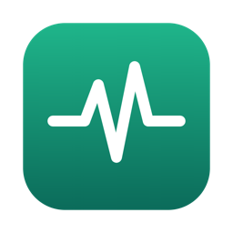

<p align="center">
  
</p>

<h1 align="center">Pulso</h1>

<p align="center">
  <strong>See what your Mac is spending, and quit it, from the menu bar.</strong>
</p>

<p align="center">
  <a href="https://github.com/angelrod/pulso/releases/latest"></a>
  
  <a href="LICENSE"></a>
  <a href="https://github.com/angelrod/pulso/actions/workflows/ci.yml"></a>
</p>

<p align="center">
  <a href="https://github.com/angelrod/pulso/releases/latest"></a>
</p>

<p align="center">
  <picture>
    <source media="(prefers-color-scheme: light)" srcset="assets/screenshot-light.png">
    
  </picture>
</p>

Pulso lives in the menu bar as a small icon and a number: the memory in use. Click it
for a panel with memory, memory pressure, swap and CPU, the apps using the most memory,
and a Quit button on each one. No window, no Dock icon.

Pulso 2 is a native Swift app. It uses about 18 MB of memory, where the 0.1 versions used
about 250 MB.

## Features

- **Memory used**, measured the way Activity Monitor measures it (app + wired +
  compressed), not `total - free`, which reads close to 100% on any Mac.
- **Memory pressure** colours the icon: plain when normal, orange on warning, red on
  critical. A Mac at 85% memory is often fine; pressure says whether it is struggling.
- **Swap** and **CPU** at a glance. App CPU is a share of the whole Mac, on the same scale
  as the CPU reading.
- **One row per app.** Every helper process counts towards its app, so Chrome shows up
  as the gigabytes it really uses, not as its largest single process.
- **Copies started by another app** get their own row, named after what started them
  (`Chrome by Raycast`), so you can tell them from your own.
- **Click a row** to bring that app to the front. A tool running inside an app (`node`
  in a terminal) brings that app.
- **Quit an app the way ⌘Q does**, after a confirmation. The app can still ask about
  unsaved work. No permission is needed.
- **Plain-language help.** Hover the ⓘ next to each reading, or open
  "What do these mean?".
- **Open at Login**, on by default, with a switch in the panel.
- **Updates itself**, through [Sparkle](https://sparkle-project.org).
- Light and dark mode. Live updates every 3 seconds.

## Install

Requires a Mac with Apple Silicon (M1 or later) and macOS 13 or later.

1. Download `Pulso-<version>.dmg` from the
   [latest release](https://github.com/angelrod/pulso/releases/latest).
2. Open it and drag **Pulso** to **Applications**. If you have Pulso 0.1, quit it first
   and choose **Replace**.
3. Open Pulso. The first time, macOS blocks it, because the app is not yet signed with
   an Apple Developer ID. To allow it, open **System Settings → Privacy & Security**,
   scroll down, and click **Open Anyway** next to the message about Pulso. You only
   need to do this once.

   From the terminal, this does the same:

   ```sh
   xattr -dr com.apple.quarantine /Applications/Pulso.app
   ```

**Open at Login.** Pulso turns this on the first time it runs from Applications. Until it
is signed with a Developer ID, it shows in **System Settings → General → Login Items →
Allow in the Background** as "Pulso — Item from unidentified developer". Turn it off
there, or with **Open at Login** in the panel; Pulso will not turn it back on by itself.

## Updates

Pulso checks for a new version once a day, and on demand with **Check for Updates…** in
the panel. When there is one, it shows what changed and installs it on your word: it
downloads, replaces itself and reopens. No dmg, no dragging.

Every update is signed with the project's private EdDSA key, and Pulso checks it against
the public key it carries. An update that does not match is refused. The check asks
GitHub for `appcast.xml` from the latest release of this repository and sends nothing
about your Mac beyond what any web request carries.

## How it measures

| Reading | Source |
|---|---|
| Memory used | `host_statistics64`: (internal − purgeable) + wired + compressor pages |
| Memory pressure | `sysctl kern.memorystatus_vm_pressure_level` |
| Swap | `sysctl vm.swapusage` |
| CPU | the change in each core's ticks between readings (`host_processor_info`) |
| Apps | `proc_listallpids` and `proc_pid_rusage` (the footprint Activity Monitor shows), grouped by the outermost `.app` bundle and by the app responsible for each process |

Pulso reads these locally and sends none of them anywhere. It can read the memory of
your own processes only, which are also the only ones you can quit, so the list is
titled "Your apps using most memory".

## Build from source

You need Xcode 16 (Swift 6).

```sh
sh native/verify.sh               # build, tests and comment check
sh native/scripts/bundle.sh       # builds native/.build/app/Pulso.app
```

| Folder | Job |
|---|---|
| `native/Sources/PulsoCore` | everything that can be tested without a window: readings, grouping, the panel's view model, the rules for Quit and Open at Login |
| `native/Sources/PulsoUI` | the panel, in SwiftUI |
| `native/Sources/Pulso` | the app: menu bar item, panel window, actions, Sparkle |
| `native/Tests` | the tests |

## License

[MIT](LICENSE) © Miguel Angel Rod
