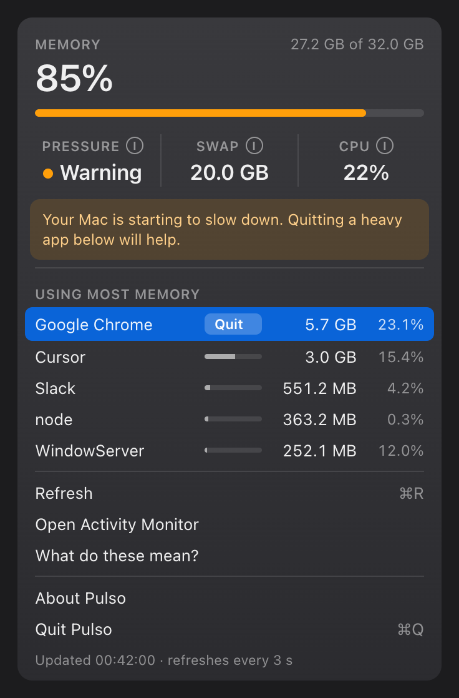

# Pulso

See what your Mac is spending, and quit it, from the menu bar.



Pulso lives in the menu bar as a small icon and a number: the memory in use. Click it
for a panel with memory, memory pressure, swap and CPU, the apps using the most memory,
and a Quit button on each one. No window, no Dock icon.

## Features

- **Memory used**, measured the way Activity Monitor measures it (app + wired +
  compressed), not `total - free`, which reads close to 100% on any Mac.
- **Memory pressure** colours the icon: plain when normal, orange on warning, red on
  critical. A Mac at 85% memory is often fine; pressure says whether it is struggling.
- **Swap** and **CPU** at a glance.
- **One row per app.** Every helper process counts towards its app, so Chrome shows up
  as the gigabytes it really uses, not as its largest single process.
- **Quit an app the way ⌘Q does**, after a confirmation. The app can still ask about
  unsaved work.
- **Plain-language help.** Hover the ⓘ next to each reading, or open
  "What do these mean?".
- Light and dark mode. Live updates every 3 seconds.

## Install

Requires a Mac with Apple Silicon (M1 or later).

1. Download `Pulso-<version>-arm64.dmg` from the
   [latest release](https://github.com/angelrod/pulso/releases/latest).
2. Open it and drag **Pulso** to **Applications**.
3. Open Pulso. The first time, macOS blocks it, because the app is not yet signed with
   an Apple Developer ID. To allow it, open **System Settings → Privacy & Security**,
   scroll down, and click **Open Anyway** next to the message about Pulso. You only
   need to do this once.

   From the terminal, this does the same:

   ```sh
   xattr -dr com.apple.quarantine /Applications/Pulso.app
   ```

The first time you quit an app from Pulso, macOS asks whether Pulso may control it.
That permission is what lets Pulso quit apps the way ⌘Q does. You can change it later
in **System Settings → Privacy & Security → Automation**.

## How it measures

| Reading | Source |
|---|---|
| Memory used | `vm_stat`: (anonymous − purgeable) + wired + occupied by compressor |
| Memory pressure | `sysctl kern.memorystatus_vm_pressure_level` |
| Swap | `sysctl vm.swapusage` |
| CPU | the change in each core's tick counters between readings (`os.cpus()`) |
| Apps | `ps`, grouped by the outermost `.app` bundle each process lives in |

Pulso reads these locally and sends none of them anywhere. Its only network request is
the update check below.

## Updates

Once a day, Pulso asks GitHub for the latest release of this repository
(`api.github.com/repos/angelrod/pulso/releases/latest`). If there is a newer version,
the panel shows it with a **Download** button that opens the release page. Download the
new `.dmg` and drag Pulso to Applications again to replace the old one.

The request sends nothing about your Mac beyond what any web request carries (your IP
address, and Pulso's version in the `User-Agent`). Automatic, in-place updates need the
app to be signed with an Apple Developer ID, which is planned.

## Build from source

You need Node.js 20 and pnpm.

```sh
pnpm install
pnpm dev          # run Pulso in the menu bar
pnpm verify       # tests, typecheck, comment check and build
```

The code is split so that most of it can be tested without Electron:

| File | Job |
|---|---|
| `src/main/metrics.ts` | pure parsing and formatting of `ps`, `vm_stat` and `sysctl` output |
| `src/main/collect.ts` | runs those commands and builds a snapshot |
| `src/main/panel.ts` | turns a snapshot into the panel's view model |
| `src/main/tray.ts` | the menu bar title, icon and tooltip |
| `src/main/quit.ts` | asks an app to quit through Apple Events |
| `src/shared/bridge.ts` | the typed bridge between the panel and the main process |
| `src/renderer/` | the panel's markup and CSS |
| `src/main/index.ts` | the only file that touches Electron at runtime |

`pnpm preview:panel` renders the panel to a PNG, to check CSS changes by eye.

## License

[MIT](LICENSE) © Miguel Angel Rod
